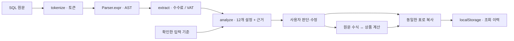
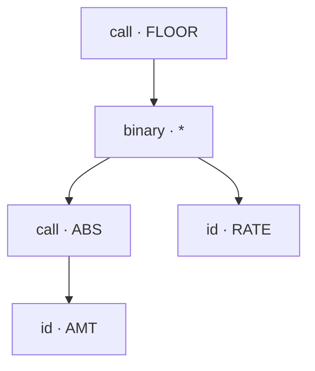

# 다날 정산 상품 생성기

MSSQL 수식으로 정산 상품을 만들고 예시 금액으로 검증하는 브라우저 도구입니다. 서버·DB에 데이터를 보내지 않습니다.

## 실행

Node.js 24 이상이 필요합니다.

```sh
npm ci
npm start
```

접속: `http://127.0.0.1:4317` · 검사: `npm run check`

브라우저 회귀 검사는 `scripts/browser-smoke.js`의 `runBrowserSmoke(page, { baseURL })`에 Playwright Page를 전달해 실행합니다. 테스트 상태·INSERT 미리보기·상품 변경 매핑·통화 필터·CSV·키보드·모바일·파일 읽기 경합·합산 단위 등 핵심 동작을 확인합니다. 새 브라우저 컨텍스트와 가상 클립보드를 사용해 기존 이력과 실제 클립보드를 건드리지 않습니다. Playwright MCP를 사용하는 경우 `node scripts/browser-smoke.js --print-code http://127.0.0.1:4317`이 `browser_run_code_unsafe` 도구에 넘길 JSON 인수를 출력합니다. 배포 URL도 같은 방식으로 확인할 수 있습니다.

## 사용

**수식 → 상품 설정 → 예시 테스트 → 완성·복사**

상단에서 현재 상품·확정한 계산 설정·예시 검증 상태를 확인하고, 단계 이동으로 작업을 이어갑니다. 넓은 화면에서는 오른쪽에 다음 작업과 완성 상품의 복사 영역을 표시합니다. 좁은 화면에서는 단계 이동을 위쪽에, 복사 영역을 완성 화면 아래에 표시합니다.

- **상품 만들기**: 서비스·예제를 선택하거나 SQL 입력. 표에서 미확정 값을 판단하고 계산 방식을 수정합니다.
  수식 입력은 17px 글꼴과 SQL 구문 강조를 지원합니다. `SQL 정렬` 또는 `Ctrl / ⌘ + Shift + F`로 MSSQL 구문을 정렬하고, `정렬 되돌리기`로 직전 원문을 복원합니다. 분석된 수식을 정렬하거나 되돌리면 다시 분석하되 선택 상품·상품명·등록 정보·직접 판단한 설정·테스트 입력을 유지합니다. 원문 위치가 달라져 예시 결과는 다시 테스트해야 합니다. 입력이 그대로인 상태에서 분석 버튼을 다시 눌러도 편집값을 지우지 않습니다. 직접 SQL을 수정하면 기존 분석을 초기화합니다. 정렬이 지원하지 않는 구문은 입력을 유지하고 오류를 안내합니다.
- **완성·복사**: 엑셀·Markdown 표 또는 `TB_SSI_MERC_SMT_GDS_M` INSERT 쿼리를 복사합니다. INSERT는 상품코드·상품명, 계산 설정과 필수 등록 정보를 확인하면 사용할 수 있습니다. 선택한 상품의 서비스·정산 구분·납부 방식·통화·계산 엔진 정보를 채우며, 직접 만든 상품은 `INSERT 등록 정보`에서 입력합니다. 등록자 ID는 직접 지정하고 등록·변경 프로그램은 이 도구의 이름, 등록·변경 시각은 `SYSTIMESTAMP`를 사용합니다. 빈 선택 항목은 생략해 DB 기본값을 유지합니다. 미적용 계산 설정은 `NULL`로 내보냅니다.
  Oracle 단일 문장 실행에 맞춰 끝의 세미콜론을 생략합니다. SQL 편집기에 직접 붙여 넣어 실행하세요.
  4단계의 `INSERT 미리보기` 또는 복사 영역의 `쿼리 미리보기`에서 실제 복사될 쿼리를 구문 강조와 함께 확인할 수 있습니다. 필수값이 빠지면 확인할 항목을 표시하고 이전 쿼리를 숨깁니다.
  DB 필수값·문자열 길이와 계산 단위 컬럼의 `NUMBER(3,0)` 범위도 검사합니다. 소수 계산 단위는 계산기에서 사용할 수 있지만 현재 DB 스키마에 그대로 저장할 수 없어 INSERT 복사를 막습니다. 스키마 확인일은 2026-11-09이며, 검증 기준은 `test/fixtures/product-insert-schema.json`에 기록합니다.
  DB에서 NULL을 허용하는 전체 15개 컬럼(계산 설정 6개, 추가 등록 정보 9개)에 NULL 선택을 제공합니다. 계산 표의 `NULL 허용` 항목은 값을 눌러 `NULL (미적용)`을 선택합니다. 예를 들어 절대값 처리 `N`에서 부호 적용 위치를 `NULL`로 확정하면 미확정 상태와 구분해 INSERT를 생성합니다. 표에는 `NULL`로 표시하며 SQL에는 따옴표 없는 `NULL`을 넣습니다. 4단계의 `NULL 허용 DB 컬럼 · 추가 등록 정보`는 기본으로 펼쳐 보이며 DB 컬럼명으로 항목을 확인할 수 있습니다. 추가 등록 정보는 빈칸이면 DB 기본값을 사용하고, `NULL 지정`을 선택하면 기본값 대신 NULL로 저장합니다. NOT NULL 컬럼에는 NULL 선택을 제공하지 않습니다.
- **정산 계산기**: 건별·합산 탭에서 금액과 요율을 독립적으로 비교합니다.
  직접 만든 상품은 현재 입력한 납부 방식·징수 방식·계산 엔진을 사용합니다. 징수 방식의 빈칸은 DB 기본값 `PRE`를 사용하고 명시적 NULL과 구분합니다. 특이 계산기, 최소 수수료, 구간·기본 요금제는 필요한 추가 입력을 지원하지 않으므로 일반 정률 계산으로 대체하지 않습니다.
  CSV·붙여넣기 데이터의 요율·단가·건수 컬럼은 선택한 상품에 따라 다시 연결합니다. 행별 상품코드를 사용하면 정률 행의 CALRATE와 정액 행의 AUTHRATE를 각각 선택합니다. 직접 선택하고 적용한 컬럼과 표에서 수정한 값은 상품을 바꿔도 유지합니다.
  붙여넣기 칸을 비워도 가져온 표의 데이터는 유지하며 그대로 계산할 수 있습니다. 파일을 읽는 동안에는 계산을 잠시 막고, 그 사이 표를 수정하거나 다른 파일을 선택하면 이전 파일 읽기 결과를 적용하지 않습니다. 취소된 파일은 같은 파일을 다시 선택할 수 있도록 선택값을 정리합니다.
  절댓값·부호를 적용하는 합산 상품은 승인과 취소를 나눠 검증합니다. 0원은 반대 부호로 취급하지 않습니다. 면세 상품의 미사용 VAT 합산 설정은 합산 여부 판단에서 제외합니다. 같은 기준을 빠른 테스트와 정산 계산기에 공통으로 적용합니다.
  유한 소수는 지원 범위인 소수점 아래 38자리까지 표시·재계산 때 값을 보존합니다. 순환소수 등 생략이 필요한 값은 `…`를 붙여 구분합니다. 큰 합계와 차트 비율도 금액을 JavaScript Number로 바꾸지 않고 계산합니다.
  SQL 원문 계산은 명시적 정수 CAST와 COUNT·SUM·AVG의 정수 결과, 정수 함수 이후 나눗셈, CAST의 정수 범위·DECIMAL 자릿수와 반올림 후 범위를 검사합니다. SUM·AVG의 정수 타입은 [SQL Server SUM](https://learn.microsoft.com/en-us/sql/t-sql/functions/sum-transact-sql)·[AVG](https://learn.microsoft.com/en-us/sql/t-sql/functions/avg-transact-sql) 문서를 기준으로 합니다. 원본 DB 컬럼의 타입·전체 SQL 타입 추론과 세션 설정까지 재현하는 엔진은 아니며, 컬럼 타입을 지정하려면 원문에 CAST를 명시하세요.
- **가상 대시보드 (Beta)**: 3단계 예시 테스트와 정산 계산기에서 실행한 최신 입력 데이터를 요약합니다. 거래 건수·순거래금액·수수료·부가세·지원 상품의 지급액, 양수·음수 거래 구성, 계산 단위별 금액과 상세 결과를 표시합니다. 거래 방향·확인 필요 결과·통화로 함께 필터링할 수 있고 상세는 20개 단위씩 볼 수 있습니다. `현재 필터 CSV`는 페이지에 보이는 20개뿐 아니라 해당 필터의 전체 결과를 내보냅니다. 합산 결과를 거래별로 배분하지 않으며 통화가 섞이면 금액 합계와 차트를 표시하지 않습니다. 통화 필터를 선택하면 같은 통화의 계산 단위만 요약합니다. 계산 불가 금액은 0원으로 대체하지 않고 제외 범위를 표시합니다. 입력·상품 설정을 바꾸면 이전 대시보드를 지우며 테스트 기록을 누적 합산하지 않습니다.
- **작업 이력**: 복사한 상품의 수식·최종 설정·예시 결과를 조회합니다. 연속으로 같은 내용을 복사하면 중복 저장하지 않습니다.
  예시 테스트의 입력을 수정하면 이전 기록은 유지하고 현재 입력은 `재테스트 필요`로 표시합니다. 같은 입력·원문 대입값·기대값을 반복 실행하면 기록을 갱신하며 검증 건수를 늘리지 않습니다. 예시는 최대 50개까지 보관하고, 한도에 도달하면 기존 기록을 직접 제외한 뒤 새 예시를 추가할 수 있습니다.
  원문 입력값의 자동 연결 여부를 각 칸 아래에 표시합니다. 두 번째 거래를 잠시 지워도 직접 입력값을 보관하며, `금액·요율 다시 연결`로 현재 거래금액·요율·건수와 다시 연결할 수 있습니다.

상품명 추천은 [플랫폼-서비스 관계](https://danal.atlassian.net/wiki/x/xYArH)의 서비스·세부서비스 명칭과 현재 계산 설정을 사용합니다. `INSERT 등록 정보`에 서비스코드를 입력한 뒤 `상품명 추천`을 누르고 추천 항목을 선택하면 상품코드·상품명 입력칸과 모든 복사 형식에 반영됩니다. 직접 입력한 이름은 추천 요청만으로 바뀌지 않습니다. 문서에서 중복되거나 서로 다른 코드가 기재된 항목은 명칭을 임의로 확정하지 않습니다. 코드 조합은 이 도구의 추천값이며, 해당 문서에 정의된 공식 상품코드 규칙을 뜻하지 않습니다.

이력은 같은 브라우저·같은 주소의 **localStorage**에 최근 50개까지 저장합니다. 서버·DB 동기화와 이력 복원·수정 기능은 없습니다. 브라우저 데이터를 지우거나 다른 기기·주소로 접속하면 해당 이력을 볼 수 없습니다. 저장 공간·권한 문제는 복사 결과와 별도로 안내합니다.

## 처리 구조



`FLOOR(ABS(AMT) * RATE)`의 AST는 계산 순서를 그대로 보존합니다.



| 코드                                  | 역할                                                                  |
| ------------------------------------- | --------------------------------------------------------------------- |
| `public/parser.js`, `update-pairs.js` | 원문 위치를 유지하며 수식 추출. 같은 대상·조건의 독립된 UPDATE만 연결 |
| `public/analyzer.js`                  | AST에서 설정·근거 도출. 미확정·별도 계산 구분                         |
| `public/calculation/`                 | 분수 연산으로 원문·상품·기대값 비교                                   |
| `public/product-examples.js`          | 55개 상품의 계산 본문, 주석 참고식, 집계 경로·조건                    |
| `public/history.js`                   | 이력 버전 검사·중복 제거·저장 실패 처리                               |

## 서비스별 계산식

실제 계산 단계를 본문으로, 합산 상품의 거래내역 계산식을 주석으로 남깁니다. `SUM(CPFEE)`처럼 건별 결과를 더하는 단계와 `요율 × SUM(AMT)`처럼 합산 후 계산하는 단계를 구분합니다. 출처 SP·행 번호·GROUP BY·조건은 예제와 접힌 근거 영역에서 확인합니다.

- 상품권발행·도서문화·컬처랜드: 금액 집계 후 계산.
- 휴대폰: 금액 합산, 수수료 합계 기반 VAT, VAT 포함 총액 재분리 등 분기별 원문 유지.
- 본인확인: 건수 집계 후 일반·기본·구간 요금 계산.
- 건별 상품: 거래 계산을 본문에 두고 집계 입력식을 주석으로 기록.
- 출처·계약 분기가 미확인인 경우 `conditional`·`unverified`로 명시. 다른 서비스의 식이나 DB 설정으로 메우지 않습니다.

매핑: `scripts/product-calculation-map.js` · 생성: `scripts/import-product-examples.js` (읽기 전용 추출 JSON 사용). DB 상품 스냅샷은 2026-11-06 기준이며 브라우저에서 DB를 조회하지 않습니다.

## 범위와 배포

전체 SP의 실행·조인·분기 흐름을 실행하는 도구가 아닙니다. 기집계 금액은 입력 설정에서 지정하며, 서로 다른 정산 단위는 나눠 검증합니다. 예시 일치는 입력한 사례에 대한 결과입니다.

`npm run build`는 정적 파일만 `dist/`에 만듭니다. `npm run preview -- /저장소명/`으로 확인하고 GitHub Pages에 배포할 수 있습니다. 공유 서버 설정은 [sharing.md](docs/sharing.md)를 참고하세요.

SQL 구문 강조(Prism)와 정렬(SQL Formatter)은 `public/vendor/`의 로컬 파일을 사용하며 외부 서비스로 SQL을 보내지 않습니다. 두 패키지를 업데이트하면 `npm run vendor:sync`로 브라우저 파일과 라이선스를 함께 갱신합니다.
